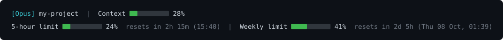

# claude-code-usage-statusline

A Windows PowerShell [status line](https://code.claude.com/docs/en/statusline) for Claude Code that shows your plan limits and context usage at a glance.



## Features

- **5-hour and weekly limits** with usage percentage, time left, and the local reset time
- **Context window bar** showing how full the current chat is (resets after `/clear`)
- **Color thresholds**: green below 70%, yellow from 70%, red from 90%
- **No dependencies**: plain PowerShell, no `jq` and no Git Bash

## Requirements

- Windows with PowerShell (the built-in `powershell` works)
- Claude Code
- A claude.ai **Pro or Max** plan for the limit lines. Without one, only the model, folder, and context bar appear.

## Install

1. Save `statusline.ps1` to `C:\Users\<you>\.claude\statusline.ps1`.
2. Add this to `C:\Users\<you>\.claude\settings.json` (merge it into the existing object if the file already has settings):

   ```json
   {
     "statusLine": {
       "type": "command",
       "command": "powershell -NoProfile -ExecutionPolicy Bypass -File C:/Users/<you>/.claude/statusline.ps1"
     }
   }
   ```

   Use forward slashes in the path. `-ExecutionPolicy Bypass` is needed because Windows blocks `.ps1` files by default.

3. Restart Claude Code and send a message. The limit data arrives with the first response of a session.

## Troubleshooting

- **Nothing shows up:** check that `settings.json` is valid JSON and that you accepted the trust prompt for the project folder. Run `claude --debug` to see script errors.
- **Only the model name shows:** the script works. Limit data needs a Pro or Max plan and at least one response in the session.
- **Boxes or `?` instead of bars:** your terminal font lacks the block characters. Windows Terminal handles them.
- **Test the script by hand:**

  ```powershell
  '{"model":{"display_name":"Opus"},"rate_limits":{"five_hour":{"used_percentage":23.5,"resets_at":1790000000}}}' | powershell -NoProfile -ExecutionPolicy Bypass -File .\statusline.ps1
  ```

## How it works

Claude Code pipes JSON about the session to the status line command on stdin. This script reads `context_window.used_percentage`, `rate_limits.five_hour`, and `rate_limits.seven_day` from that JSON and prints two lines. See the [official status line docs](https://code.claude.com/docs/en/statusline) for every available field.

## License

MIT
